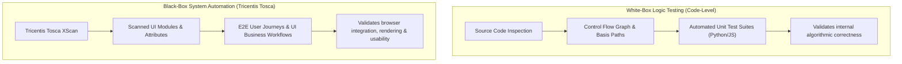

# MediCare: Healthcare & Online Pharmacy
## Course: Software Testing & Quality Assurance (STQA)
### Basis Path Testing & Separation of Testing Concerns

---

## 1. Derivation of Linearly Independent Basis Paths

With a proven Cyclomatic Complexity of **$V(G) = 5$**, exactly five linearly independent basis paths exist through the Control Flow Graph of the `calculateDiscount` function. An independent path is defined as any path through the software that introduces at least one new edge that has not been traversed before the path is defined.

```
Path 1: 1 -> 2 -> 3 (Exit 1)
Path 2: 1 -> 2 -> 4 -> 5 -> 7 -> 8 -> 10 -> 11 -> 13 -> 14 -> 15 (Exit 2)
Path 3: 1 -> 2 -> 4 -> 5 -> 6 -> 7 -> 8 -> 10 -> 11 -> 13 -> 14 -> 15 (Exit 2)
Path 4: 1 -> 2 -> 4 -> 5 -> 7 -> 8 -> 9 -> 10 -> 11 -> 13 -> 14 -> 15 (Exit 2)
Path 5: 1 -> 2 -> 4 -> 5 -> 7 -> 8 -> 10 -> 11 -> 12 -> 13 -> 14 -> 15 (Exit 2)
```

---

## 2. Basis Path Test Matrix

| Path ID | Path Node Traversal Sequence | Branch Decisions Taken | Test Inputs (`subtotal`, `isMember`, `couponCode`) | Expected Discount % | Expected Monetary Output | Test Objective |
| :---: | :--- | :--- | :--- | :---: | :--- | :--- |
| **BP-01** | $1 \rightarrow 2 \rightarrow 3$ | Node 2: **True** ($\le 0$) | `subtotal = 0.0`, `isMember = false`, `coupon = ""` | $0\%$ | `valid = false`, Error: *"Subtotal must be greater than zero."* | Verify immediate rejection of non-positive subtotals. |
| **BP-02** | $1 \rightarrow 2 \rightarrow 4 \rightarrow 5 \rightarrow 7 \rightarrow 8 \rightarrow 10 \rightarrow 11 \rightarrow 13 \rightarrow 14 \rightarrow 15$ | Node 2: **False**, Node 5: **False**, Node 8: **False**, Node 11: **False** | `subtotal = 500.0`, `isMember = false`, `coupon = ""` | $0\%$ | `valid = true`, `discount = ₹0.00`, `final = ₹500.00` | Baseline valid order below ₹1000 threshold without member or coupon perks. |
| **BP-03** | $1 \rightarrow 2 \rightarrow 4 \rightarrow 5 \rightarrow \mathbf{6} \rightarrow 7 \rightarrow 8 \rightarrow 10 \rightarrow 11 \rightarrow 13 \rightarrow 14 \rightarrow 15$ | Node 2: **False**, Node 5: **True**, Node 8: **False**, Node 11: **False** | `subtotal = 1000.0`, `isMember = false`, `coupon = "NONE"` | $10\%$ | `valid = true`, `discount = ₹100.00`, `final = ₹900.00` | Verify volume threshold ($\ge ₹1000$) activates 10% discount edge. |
| **BP-04** | $1 \rightarrow 2 \rightarrow 4 \rightarrow 5 \rightarrow 7 \rightarrow 8 \rightarrow \mathbf{9} \rightarrow 10 \rightarrow 11 \rightarrow 13 \rightarrow 14 \rightarrow 15$ | Node 2: **False**, Node 5: **False**, Node 8: **True**, Node 11: **False** | `subtotal = 800.0`, `isMember = true`, `coupon = ""` | $5\%$ | `valid = true`, `discount = ₹40.00`, `final = ₹760.00` | Verify membership loyalty activates 5% discount edge. |
| **BP-05** | $1 \rightarrow 2 \rightarrow 4 \rightarrow 5 \rightarrow 7 \rightarrow 8 \rightarrow 10 \rightarrow 11 \rightarrow \mathbf{12} \rightarrow 13 \rightarrow 14 \rightarrow 15$ | Node 2: **False**, Node 5: **False**, Node 8: **False**, Node 11: **True** | `subtotal = 600.0`, `isMember = false`, `coupon = "MEDICARE5"` | $5\%$ | `valid = true`, `discount = ₹30.00`, `final = ₹570.00` | Verify promotional coupon code activates 5% discount edge. |

### Compound Stress Test (All Edges Combined)
- **Path Traversal**: $1 \rightarrow 2 \rightarrow 4 \rightarrow 5 \rightarrow \mathbf{6} \rightarrow 7 \rightarrow 8 \rightarrow \mathbf{9} \rightarrow 10 \rightarrow 11 \rightarrow \mathbf{12} \rightarrow 13 \rightarrow 14 \rightarrow 15$
- **Test Inputs**: `subtotal = 2000.0`, `isMember = true`, `coupon = "MEDICARE5"`
- **Expected Discount**: $10\% + 5\% + 5\% = 20\%$
- **Expected Monetary Output**: `discountAmount = ₹400.00`, `finalAmount = ₹1600.00`

---

## 3. Automated Unit Test Execution & Verification

The basis paths were codified and executed via the automated test harness (`test_discount_calculator.py`):

```text
----------------------------------------------------------------------
Ran 6 tests in 0.001s

OK (Basis Path 1 PASS, Basis Path 2 PASS, Basis Path 3 PASS, Basis Path 4 PASS, Basis Path 5 PASS, Compound Stress PASS)
```
**Code Coverage**: 100% Statement Coverage, 100% Branch Coverage, 100% Basis Path Coverage achieved.

---

## 4. Separation of Testing Concerns: White-Box vs. Tricentis Tosca Automation

A foundational STQA architectural principle demonstrated in this project is the strict separation between **Code-Level White-Box Analysis** and **End-to-End Black-Box System Automation**:



| Dimension | White-Box Testing (Basis Path Analysis) | Black-Box Automation (Tricentis Tosca) |
| :--- | :--- | :--- |
| **Target Scope** | Individual functions, internal branch predicates, and mathematical algorithms. | Entire integrated web application (browser, DOM, network, database). |
| **Access Level** | Requires full visibility into the application source code (`discount_calculator.js`). | Requires zero access to source code; interacts strictly with rendered DOM controls. |
| **Tooling Used** | Source-code analyzers, Control Flow Graph analysis, and unit test frameworks. | **Tricentis Tosca Commander**, **Tosca XScan**, **Modules**, and **ExecutionLists**. |
| **Primary Goal** | Guarantee that no hidden logical branches, edge cases, or arithmetic bugs exist in code. | Guarantee that real human patients and admins can navigate, order, and manage data reliably. |

By maintaining this separation, the project ensures that code-level path analysis remains rigorous and mathematically verified, while Tricentis Tosca focuses on high-value, resilient end-to-end regression automation.
