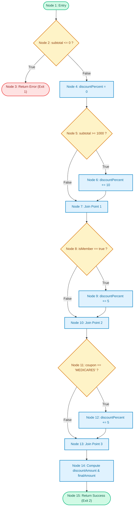

# MediCare: Healthcare & Online Pharmacy
## Course: Software Testing & Quality Assurance (STQA)
### White-Box Testing: Control Flow Graph (CFG)

---

## 1. Algorithm Specification & Source Code

To implement rigorous white-box structural testing, the core financial component—**Checkout Discount Calculation Engine**—is formally analyzed. This module enforces multi-tiered business logic governing order subtotal validation, volume discounts, membership loyalty perks, and promotional vouchers.

### Source Code Under Test (`discount_calculator.js` / `discount_calculator.py`)

```javascript
function calculateDiscount(subtotal, isMember = false, couponCode = '') {
    // Node 1: Entry
    // Node 2: Decision 1 - Validate subtotal
    if (subtotal <= 0) {
        // Node 3: Exit 1 - Invalid Subtotal Rejection
        return { valid: false, error: "Subtotal must be greater than zero." };
    }

    // Node 4: Sequential - Initialize base discount
    let discountPercent = 0;

    // Node 5: Decision 2 - Volume Discount Check (>= 1000)
    if (subtotal >= 1000) {
        // Node 6: Action - Apply 10% volume discount
        discountPercent += 10;
    }
    // Node 7: Join Point 1 (after subtotal threshold check)

    // Node 8: Decision 3 - Member Loyalty Check
    if (isMember === true) {
        // Node 9: Action - Apply 5% membership discount
        discountPercent += 5;
    }
    // Node 10: Join Point 2 (after membership check)

    // Node 11: Decision 4 - Promotional Voucher Check
    if (couponCode === 'MEDICARE5') {
        // Node 12: Action - Apply 5% coupon discount
        discountPercent += 5;
    }
    // Node 13: Join Point 3 (after coupon check)

    // Node 14: Sequential - Calculate monetary values
    const discountAmount = Math.round(((subtotal * discountPercent) / 100) * 100) / 100;
    const finalAmount = Math.round((subtotal - discountAmount) * 100) / 100;

    // Node 15: Exit 2 - Success Output
    return {
        valid: true,
        subtotal: subtotal,
        discountPercent: discountPercent,
        discountAmount: discountAmount,
        finalAmount: finalAmount
    };
}
```

---

## 2. Formal Breakdown of Nodes

| Node Number | Node Classification | Statement / Expression in Source Code |
| :---: | :--- | :--- |
| **Node 1** | **Entry Node** | Function entry: receive `subtotal, isMember, couponCode` |
| **Node 2** | **Predicate Node (Decision 1)** | `if (subtotal <= 0)` |
| **Node 3** | **Terminal Exit Node 1** | Return `{ valid: false, error: "Subtotal must be greater than zero." }` |
| **Node 4** | **Sequential Action Node** | `let discountPercent = 0;` |
| **Node 5** | **Predicate Node (Decision 2)** | `if (subtotal >= 1000)` |
| **Node 6** | **Action Node** | `discountPercent += 10;` |
| **Node 7** | **Join / Merge Node 1** | Junction point merging True (Node 6) and False branches of Decision 2 |
| **Node 8** | **Predicate Node (Decision 3)** | `if (isMember === true)` |
| **Node 9** | **Action Node** | `discountPercent += 5;` |
| **Node 10** | **Join / Merge Node 2** | Junction point merging True (Node 9) and False branches of Decision 3 |
| **Node 11** | **Predicate Node (Decision 4)** | `if (couponCode === 'MEDICARE5')` |
| **Node 12** | **Action Node** | `discountPercent += 5;` |
| **Node 13** | **Join / Merge Node 3** | Junction point merging True (Node 12) and False branches of Decision 4 |
| **Node 14** | **Sequential Action Node** | Compute `discountAmount` and `finalAmount` arithmetic |
| **Node 15** | **Terminal Exit Node 2** | Return `{ valid: true, subtotal, discountPercent, discountAmount, finalAmount }` |

---

## 3. Directed Edges in the Graph

The Control Flow Graph contains **17 directed edges** governing the transfer of execution control:
1. $e_1 = (1 \rightarrow 2)$: Flow from function entry to subtotal validation
2. $e_2 = (2 \rightarrow 3)$: True branch of Decision 1 (invalid subtotal branch to Exit 1)
3. $e_3 = (2 \rightarrow 4)$: False branch of Decision 1 (valid subtotal proceeds to initialization)
4. $e_4 = (4 \rightarrow 5)$: Flow from initialization to volume discount check
5. $e_5 = (5 \rightarrow 6)$: True branch of Decision 2 ($\text{subtotal} \ge 1000$)
6. $e_6 = (6 \rightarrow 7)$: Flow from 10% discount accumulation to Join Point 1
7. $e_7 = (5 \rightarrow 7)$: False branch of Decision 2 ($\text{subtotal} < 1000$)
8. $e_8 = (7 \rightarrow 8)$: Flow from Join Point 1 to membership check
9. $e_9 = (8 \rightarrow 9)$: True branch of Decision 3 ($\text{isMember} = \text{true}$)
10. $e_{10} = (9 \rightarrow 10)$: Flow from 5% loyalty discount accumulation to Join Point 2
11. $e_{11} = (8 \rightarrow 10)$: False branch of Decision 3 ($\text{isMember} = \text{false}$)
12. $e_{12} = (10 \rightarrow 11)$: Flow from Join Point 2 to coupon code check
13. $e_{13} = (11 \rightarrow 12)$: True branch of Decision 4 ($\text{couponCode} = \text{'MEDICARE5'}$)
14. $e_{14} = (12 \rightarrow 13)$: Flow from 5% voucher discount accumulation to Join Point 3
15. $e_{15} = (11 \rightarrow 13)$: False branch of Decision 4 ($\text{couponCode} \ne \text{'MEDICARE5'}$)
16. $e_{16} = (13 \rightarrow 14)$: Flow from Join Point 3 to final arithmetic calculation
17. $e_{17} = (14 \rightarrow 15)$: Flow from calculation to successful Exit 2

*(Note: In standard McCabe single-terminal graph convention, connecting Exit 3 and Exit 15 to a single program exit terminal yields $N=15, E=18$).*

---

## 4. Visual Control Flow Graph (Mermaid Diagram)


