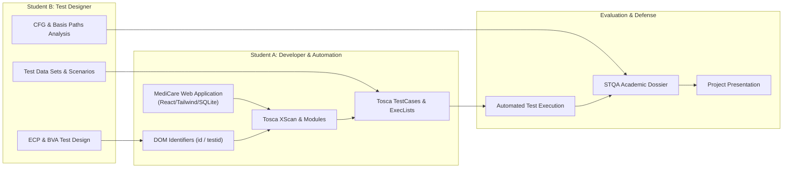

# MediCare: Healthcare & Online Pharmacy
## Course: Software Testing & Quality Assurance (STQA)
### Pair Work Division & Responsibility Allocation

---

## 1. Project Partnership Overview

This STQA mini-project was executed as a collaborative two-person engineering and quality assurance team. Work was cleanly divided between **Application Architecture & Test Automation Engineering (Student A)** and **Mathematical Test Design & Quality Assurance Analysis (Student B)** to ensure comprehensive coverage across both full-stack software development and theoretical testing domains.

---

## 2. Core Role Profiles

### Student A: Ganesh BS (USN: 20251LIE3003)
- **Designation**: Application Developer & Tosca Automation Engineer
- **Primary Ownership**: System Architecture, Web Application Development, Database Engineering, and Tricentis Tosca Automation Implementation.
- **Key Responsibilities**:
  1. Engineering the full-stack MediCare application across all twelve modules using React.js, Tailwind CSS, Express.js/Python, and SQLite.
  2. Enforcing DOM testability standards: embedding static, predictable HTML `id` and `data-testid` attributes across all forms, tables, and buttons.
  3. Configuring the Tricentis Tosca Commander workspace, HTML 3.0 engine settings, and browser extension integrations.
  4. Performing page scanning across all screens using **Tosca XScan** to generate technical **Modules**.
  5. Translating test scenarios into operational Tosca **TestCases** with ActionModes (`Input`, `Verify`, `Buffer`, `WaitOn`).
  6. Assembling **ExecutionLists**, configuring browser test parameters, and overseeing end-to-end execution.

### Student B: Shiva kumar rathod (USN: 20251LIE3010)
- **Designation**: Test Designer & QA Analyst
- **Primary Ownership**: Black-Box Test Design, White-Box Structural Analysis, Test Data Engineering, and STQA Quality Documentation.
- **Key Responsibilities**:
  1. Formulating formal **Equivalence Class Partitioning (ECP)** tables across input boundaries (Age, Password, Email, Quantity).
  2. Constructing comprehensive 7-point **Boundary Value Analysis (BVA)** matrices ($\text{Min}-1, \text{Min}, \text{Min}+1, \text{Nominal}, \text{Max}-1, \text{Max}, \text{Max}+1$).
  3. Modeling the **Control Flow Graph (CFG)** for the checkout discount algorithm, numbering nodes, decision predicates, and edges.
  4. Calculating **Cyclomatic Complexity $V(G) = 5$** using all three independent mathematical formulas.
  5. Identifying all five linearly independent basis paths and verifying them using an automated unit test suite.
  6. Authoring comprehensive STQA academic documentation and analyzing test execution metrics.

---

## 3. RACI Responsibility Matrix

*(R = Responsible, A = Accountable, C = Consulted, I = Informed)*

| Project Deliverable / Activity Area | Ganesh BS (20251LIE3003) - Dev & Automation | Shiva kumar rathod (20251LIE3010) - QA & Design |
| :--- | :---: | :---: |
| **System Architecture & Database Schema** | **R / A** | C |
| **Frontend UI/UX (React & Tailwind CSS)** | **R / A** | C |
| **Backend REST APIs (Node.js & Python)** | **R / A** | I |
| **DOM Selector & Tosca XScan Compatibility** | **R / A** | C |
| **Equivalence Class Partitioning (ECP) Design** | C | **R / A** |
| **Boundary Value Analysis (BVA) Design** | C | **R / A** |
| **Control Flow Graph (CFG) Construction** | C | **R / A** |
| **Cyclomatic Complexity Mathematical Derivations** | I | **R / A** |
| **Basis Path Test Harness & Execution** | C | **R / A** |
| **Tosca Workspace & Browser Engine Setup** | **R / A** | C |
| **Tosca XScan Page Scanning & Module Creation** | **R / A** | C |
| **Tosca TestCase Design & TestStepValues** | **R / A** | C |
| **Tosca ExecutionLists & ExecutionLogs** | **R / A** | C |
| **STQA Academic Documentation Suite** | C | **R / A** |
| **PowerPoint Defense Presentation** | **R** | **R** |

---

## 4. Collaborative Engineering Workflow

This clear division ensured balanced effort, eliminated duplicative work, and resulted in a project that seamlessly integrates software development, theoretical test analysis, and model-based automation.
