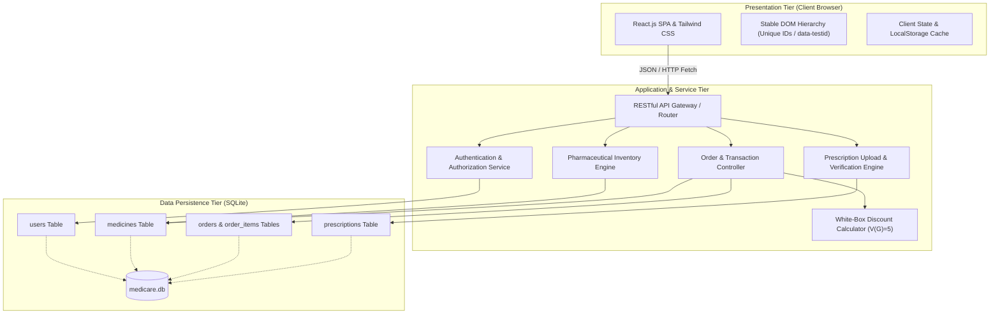
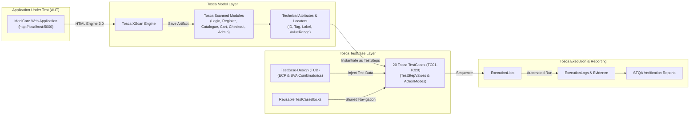

# MediCare: Healthcare & Online Pharmacy
## Course: Software Testing & Quality Assurance (STQA)
### System & Automation Architecture Specification

---

## 1. Multi-Tier Application Architecture

The **MediCare** platform is structured upon an industry-standard decoupled 3-tier architectural model, isolating the User Interface, Business Logic, and Data Persistence layers:

### Layer Details
1. **Presentation Tier (Frontend)**:
   - Built as a high-performance Single-Page Application (SPA) utilizing React.js and Tailwind CSS.
   - Strictly enforces clean DOM structures (`<form>`, `<table id="...">`, `<label for="...">`, `<input id="...">`) with fixed identifier attributes that provide deterministic anchors for **Tosca XScan**.
2. **Application Tier (Backend REST APIs)**:
   - Provided via dual interchangeable runtimes:
     - **Node.js + Express.js**: Standard enterprise JavaScript REST API server.
     - **Python 3.10 Engine**: Zero-dependency standalone HTTP server using Python's standard library to guarantee instant execution without third-party package downloads.
   - Exposes RESTful endpoints over port 5000: `/api/auth/*`, `/api/medicines/*`, `/api/orders/*`, `/api/prescriptions/*`, and `/api/cart/calculate-discount`.
3. **Data Tier (Persistence)**:
   - Relational database implemented in **SQLite 3** (`medicare.db`).
   - Ensures ACID compliance for transactional order processing and stock deductions.

---

## 2. Tricentis Tosca Model-Based Automation Architecture

The automation architecture adheres rigorously to the **Tricentis Tosca Model-Based Test Automation (MBTA)** paradigm. In contrast to code-based frameworks where test logic and locators are merged into script files, Tosca cleanly decouples the application technical model from the test case execution:

### Core Tosca Architectural Primitives
1. **Tosca XScan**:
   - Ingests the live DOM of MediCare via the **HTML Engine 3.0 / Tricentis Automation Extension**.
   - Identifies controls via `ID` and `Tag` properties. Because MediCare supplies explicit, static HTML IDs (e.g., `login-email`, `add-to-cart-1`, `cart-quantity`), XScan achieves a 100% Unique Identification Score without requiring multi-property XPath heuristics.
2. **Tosca Modules**:
   - Serve as the technical abstraction layer representing scanned application screens.
   - Contains **ModuleAttributes** corresponding to web controls (textboxes, buttons, links, tables).
   - If UI styling or layout changes in the future, only the Module is rescanned; all linked TestCases remain completely intact.
3. **Tosca TestCases & TestStepValues**:
   - Formulate business test scenarios using declarative **ActionModes**:
     - `Input`: Types data into fields (e.g., entering patient email).
     - `Verify`: Asserts that an actual value matches the expected value (e.g., verifying error text or status badge).
     - `Buffer`: Captures dynamic runtime values (e.g., storing the generated `order-id` into `{B[GeneratedOrderID]}`).
     - `WaitOn`: Synchronizes dynamically on asynchronous DOM updates without fragile hard-coded sleep delays.
4. **Tosca ExecutionLists**:
   - Organize and orchestrate batch execution of test cases against specific browser targets.
   - Record granular step-by-step pass/fail execution logs, execution timestamps, and failure screenshots.
