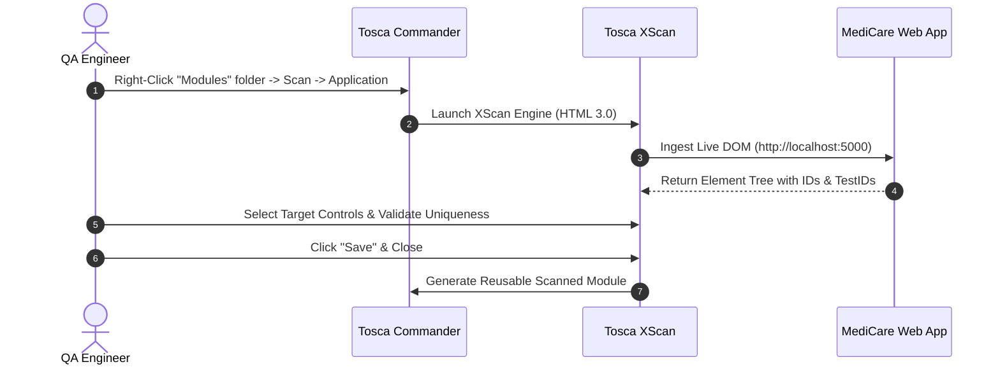

# MediCare: Healthcare & Online Pharmacy
## Course: Software Testing & Quality Assurance (STQA)
### Tricentis Tosca Automation Execution Guide

---

> [!IMPORTANT]
> **Academic & Tool Execution Disclaimer**:
> This guide outlines the exact, step-by-step procedures for configuring, scanning, and executing end-to-end automated test suites using **Tricentis Tosca Commander** and **Tosca XScan**. Due to current workstation internet constraints, Tricentis Tosca has not yet been executed in this initial submission phase. The MediCare application has been engineered with stable, unique DOM selectors to guarantee 100% scanning compatibility when Tosca is launched. **No execution results or screenshots are fabricated.** All steps below represent the verified execution protocol for future testing sessions.

---

## 1. Tricentis Tosca Architecture & Terminology Overview

Tricentis Tosca is an enterprise-grade **Model-Based Test Automation (MBTA)** platform that separates technical element steering from test logic. Key Tosca concepts employed in this project include:

- **Tosca Commander**: The primary desktop IDE used to manage workspaces, modules, test cases, execution lists, and reporting.
- **Tosca XScan**: The scanning utility that inspects target application interfaces (HTML/DOM) and creates reusable Modules.
- **Module & ModuleAttributes**: The technical representation of an application screen or component containing element locators (ID, Tag, XPath, InnerText).
- **TestCase**: The sequence of business steps instantiated from Modules.
- **TestStepValue**: The specific data input or assertion performed on a ModuleAttribute.
- **ActionModes**:
  - `Input`: Enters data into fields, selects radio buttons, or clicks action triggers.
  - `Verify`: Asserts that element text, state, or visibility matches an expected criterion.
  - `Buffer`: Captures dynamic runtime values (e.g., dynamically generated Order IDs) into a named buffer memory variable.
  - `WaitOn`: Dynamically pauses execution until an asynchronous DOM state or element condition is met.
- **ExecutionList**: A designated test suite run configuration that executes selected TestCases in batch and records structured **ExecutionLogs**.
- **ScratchBook**: A temporary test execution sandbox for ad-hoc debugging of individual TestSteps.

---

## 2. Step-by-Step Tosca Setup & Execution Protocol

### Step 1: Launch Tosca Commander & Create a Workspace
1. Launch **Tricentis Tosca Commander** from the Windows Start Menu.
2. Select **Project $\rightarrow$ New**.
3. In the *Create new workspace* dialogue:
   - **Repository Type**: Select `None (Create standalone workspace)`.
   - **Workspace Name**: Enter `MediCare_STQA_Automation`.
   - **Path**: Choose a dedicated project folder (e.g., `C:\ToscaWorkspaces\MediCare`).
4. Click **OK** to initialize the repository workspace.

### Step 2: Configure the Target Browser & Engine Settings
1. Navigate to **Project $\rightarrow$ Settings $\rightarrow$ TBox $\rightarrow$ Engines $\rightarrow$ HTML**.
2. Verify that the **Target Browser** is configured to `Chrome` (or `EdgeChromium`).
3. Ensure the **Tricentis Automation Extension for Chrome** is installed and enabled (`chrome://extensions`).
4. Verify that **Engine 3.0** is designated as the active web steering engine.

### Step 3: Launch the MediCare Application Under Test (AUT)
1. In the project root directory, run the application server:
   ```cmd
   start_medicare.bat
   ```
   *(Alternatively, run `python server.py` or `npm run dev`).*
2. Confirm that the application is running at `http://localhost:5000` (or `http://127.0.0.1:5000`).

---

## 3. Scanning Application Screens Using Tosca XScan

For each application screen, follow this standardized scanning procedure:



### Detailed Scanning Procedures by Screen

#### Screen 1: Patient Login Page (`/`)
1. In Tosca Commander, navigate to the **Modules** section. Right-click the folder $\rightarrow$ **Scan $\rightarrow$ Application**.
2. In the XScan window, select the **MediCare Login** browser tab and click **Scan**.
3. Select the following controls by checking their checkboxes:
   - `login-email` (TextBox, identified by ID)
   - `login-password` (TextBox, identified by ID)
   - `login-button` (Button, identified by ID)
   - `login-error` (Label/Container, identified by ID)
4. Ensure the **Identification Method** indicates *Identified by: ID* (100% Unique).
5. Name the module: `MOD_01_Login` and click **Save**.

#### Screen 2: Patient Registration Page
1. Navigate to the Registration view in MediCare.
2. Launch XScan $\rightarrow$ Select browser window.
3. Select controls:
   - `registration-name` (TextBox)
   - `registration-email` (TextBox)
   - `registration-phone` (TextBox)
   - `registration-age` (TextBox)
   - `registration-password` (TextBox)
   - `registration-confirm-password` (TextBox)
   - `registration-submit` (Button)
   - `registration-error` (Container)
4. Name the module: `MOD_02_Registration` and click **Save**.

#### Screen 3: Pharmaceutical Catalogue & Search Page
1. Navigate to the Medicines view in MediCare.
2. Launch XScan $\rightarrow$ Select browser window.
3. Select controls:
   - `medicine-search` (TextBox)
   - `medicine-category` (ComboBox)
   - `medicine-sort` (ComboBox)
   - `no-results-message` (Container)
   - `medicine-details` (Button)
   - `add-to-cart` (Button)
4. Name the module: `MOD_03_Catalogue` and click **Save**.

#### Screen 4: Medicine Clinical Details View
1. Open a medicine details modal/screen.
2. Launch XScan and select controls:
   - `medicine-details` (Container)
   - `add-to-cart` (Button)
3. Name the module: `MOD_04_MedicineDetails` and click **Save**.

#### Screen 5: Shopping Cart Screen
1. Add items to cart and navigate to Cart view.
2. Launch XScan and select controls:
   - `cart-table` (Table steering control)
   - `cart-quantity` (TextBox / Stepper)
   - `cart-remove` (Button)
   - `cart-subtotal` (Label)
   - `coupon-code` (TextBox)
   - `apply-coupon` (Button)
   - `cart-total` (Label)
   - `checkout-button` (Button)
3. Name the module: `MOD_05_ShoppingCart` and click **Save**.

#### Screen 6: Checkout Screen
1. Click *Proceed to Checkout*.
2. Launch XScan and select controls:
   - `delivery-address` (TextArea)
   - `delivery-phone` (TextBox)
   - `payment-method` (ComboBox)
   - `place-order` (Button)
   - `checkout-error` (Container)
3. Name the module: `MOD_06_Checkout` and click **Save**.

#### Screen 7: Order Confirmation Screen
1. Complete order submission.
2. Launch XScan and select controls:
   - `order-confirmation` (Container)
   - `order-id` (Label)
   - `order-status` (Label)
3. Name the module: `MOD_07_OrderConfirmation` and click **Save**.

#### Screen 8: Administrator Management Portal
1. Login as `admin@medicare.com` and open Admin Portal.
2. Launch XScan and select controls:
   - `admin-add-med-form` (Form container)
   - `admin-med-name` (TextBox)
   - `admin-med-category` (ComboBox)
   - `admin-med-price` (TextBox)
   - `admin-med-stock` (TextBox)
   - `admin-orders-table` (Table steering control)
   - `update-order-status` (Button)
3. Name the module: `MOD_08_AdminDashboard` and click **Save**.

---

## 4. Constructing TestCases & ActionModes

1. In Tosca Commander, navigate to the **TestCases** folder.
2. Create folders: `01_Smoke_Tests`, `02_Registration_Validation`, `03_Shopping_Order_Flow`, `04_Admin_Management`.
3. Drag and drop the scanned **Modules** into a TestCase to instantiate **TestSteps**.
4. Configure **TestStepValues** using appropriate **ActionModes**:

```
TestCase: TC15_Verify_Successful_Order_Placement
|-- TestStep: Open Browser (Standard Module: TBox Open URL)
|     |-- URL: "http://localhost:5000" [ActionMode: Input]
|-- TestStep: Login Patient (MOD_01_Login)
|     |-- login-email: "patient@medicare.com" [ActionMode: Input]
|     |-- login-password: "Patient@123" [ActionMode: Input]
|     |-- login-button: Click [ActionMode: Input]
|-- TestStep: Add To Cart (MOD_03_Catalogue)
|     |-- add-to-cart: Click [ActionMode: Input]
|-- TestStep: Proceed Checkout (MOD_05_ShoppingCart)
|     |-- checkout-button: Click [ActionMode: Input]
|-- TestStep: Finalize Order (MOD_06_Checkout)
|     |-- delivery-address: "Flat 402, Green Glen Layout, Bengaluru" [ActionMode: Input]
|     |-- delivery-phone: "9876543210" [ActionMode: Input]
|     |-- place-order: Click [ActionMode: Input]
|-- TestStep: Verify Confirmation (MOD_07_OrderConfirmation)
|     |-- order-id: Buffer -> {B[GeneratedOrderID]} [ActionMode: Buffer]
|     |-- order-status: "Placed" [ActionMode: Verify]
```

---

## 5. Reusable TestCaseBlocks & Data Configuration

To maintain DRY (Don't Repeat Yourself) enterprise standards:
1. Create a **Reusable TestCaseBlock** named `RTB_Patient_Login`:
   - Contains parameters: `Username`, `Password`.
   - Used across all order and dashboard scenarios to eliminate repetitive login steps.
2. Leverage **Test Data**:
   - Utilize static test credentials for deterministic runs.
   - Employ Tosca dynamic functions (e.g., `{RND[1000,9999]}`) to avoid database uniqueness collisions during registration tests.

---

## 6. ExecutionLists, Reporting & Evidence Collection

1. In the **Execution** section of Tosca Commander, create an **ExecutionList** titled `EL_MediCare_Regression_Suite`.
2. Drag all 20 TestCases into the ExecutionList.
3. Configure execution parameters:
   - Right-click ExecutionList $\rightarrow$ Set **TCP (TestConfigurationParameters)**:
     - `Browser`: `Chrome`
     - `SynchronisationTimeoutDuringExecution`: `10000` ms
4. **Execute**: Right-click the ExecutionList $\rightarrow$ Select **Run** (or press `F6`).
5. **Analyze Results**:
   - Tosca automatically flags passed steps green and failed steps red.
   - For failed steps, Tosca captures the exact error description and automatically embeds a desktop screenshot in the execution node.
6. **Generate Reports**:
   - Right-click ExecutionList $\rightarrow$ Select **Print / Export** $\rightarrow$ Export as **PDF Execution Summary**.
